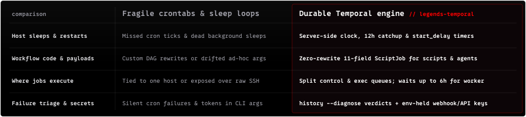

<a id="top"></a>

<p align="center"></p>

# legends-temporal: durable Temporal schedules, delayed timers, and workflow diagnosis in plain english

[](https://github.com/avalonreset/legends-temporal/releases/latest)
[](#reference)
[](docs/CLI-CONTRACT.json)
[](knowledge/temporal/pack.json)
[](LICENSE)

Every week, developers try to automate recurring jobs, rank checks, or delayed follow-ups by reaching for whatever timer sits closest at hand: a background `sleep` loop in a terminal, a local workstation crontab, or the built-in scheduled prompts tab inside a desktop AI chat app. Within days, a laptop sleeps through a 2:30am run, a subshell exits and kills the background timer, or an unattended 3:00am chat prompt stalls behind an interactive approval popup.

**The human is the controller. The agents do the operating. Stop being your computer's assistant.**

`legends-temporal` gives your coding agent an industry-standard Temporal control plane without forcing you to rewrite working scripts into custom workflow code. Register the [`cto-legends`](https://github.com/avalonreset/cto-legends) router once, state your schedule or timer in plain english, and your agent previews the plan, stores the clock on a durable Temporal server, dispatches the job to the machine where your data lives, and distills any failed run into a single-screen verdict.

<p align="center"></p>

```text
Use cto-legends to install legends-temporal, run the doctor check, and preview a
local SQLite-persisted Temporal dev server or connect to my cluster before scheduling jobs.
```

<p align="center"></p>

[Plain english](#hand-temporal-to-your-agent-in-plain-english) · [Why built-in schedulers fail](#why-chat-app-schedulers-crontabs-and-sleep-loops-fail) · [Split control & exec planes](#split-control-and-exec-queues-without-workflow-rewrites) · [Audit & bootstrap](#orphaned-queue-audits-and-one-command-cluster-bootstrap) · [Reference](#reference)

---

## Hand Temporal to your agent in plain english

You should never have to memorize `temporal` CLI flags, write boilerplate workflow classes, or dig through raw protobuf history dumps to find out why a nightly job exited non-zero. You state the outcome across the desk in plain english, and your coding agent handles the plumbing.

<p align="center"></p>

Start with a sentence you actually say during a build.

**"Schedule our GeoGrid and DataForSEO rank checks every Monday at 6am."**

Because `legends-temporal` was built as the durable clock for the rest of the [`cto-legends`](https://github.com/avalonreset/cto-legends) stack, your agent does not have to cobble together shell wrappers or virtual environment paths. Passing `--module` turns any installed module, including [`legends-geogrid`](https://github.com/avalonreset/legends-geogrid), [`legends-dataforseo`](https://github.com/avalonreset/legends-dataforseo), [`legends-firecrawl`](https://github.com/avalonreset/legends-firecrawl), [`legends-stripe`](https://github.com/avalonreset/legends-stripe), [`legends-buzz`](https://github.com/avalonreset/legends-buzz), or [`legends-empire`](https://github.com/avalonreset/legends-empire), into a server-side Temporal schedule with overlap protection and a catchup window.

**"Set a timer for 15 minutes to check the deployment and wake my session."**

Instead of spawning a fragile `sleep 900` process that dies the moment the subshell closes, your agent previews a one-shot delayed timer built on Temporal `start_delay`. The server holds the countdown in durable storage and fires the script, module call, env-held webhook, or agent session wakeup when the clock expires.

**"Audit our schedules and make sure no queue is orphaned."**

Your agent runs `legends-temporal audit`, checking every live schedule on the server against active task-queue pollers, scanning arguments for accidentally embedded secrets, and comparing your git-tracked schedule inventory against the live cluster to flag missing or drifted jobs.

**"Why did last night's workflow fail?"**

Rather than dumping hundreds of raw protobuf events into your chat window, your agent runs `workflow history --diagnose` and hands you a compact verdict: the failed activity, the exact script exit code, the worker identity, the last lines of output, whether the failure notice was delivered, and what to fix next.

---

## Why chat-app schedulers, crontabs, and sleep loops fail

Most people only discover the limits of built-in chat-app schedulers and host crontabs after an important job silently skips a night.

Desktop AI chat apps treat scheduled prompts as interactive UI turns. Many enforce one-hour minimum cadence walls, lock your schedules inside a single vendor's app, and pause behind an interactive permission popup at 3:00am the moment a turn tries to run a command. Meanwhile, a host crontab ties the clock to a single physical machine: if your workstation is asleep when a local GPU or vault job is due, the tick is lost.

<p align="center"></p>

Temporal solves the clock problem at the infrastructure layer, and yet raw Temporal introduces its own friction for coding agents. If an unguided agent writes custom Python `@workflow.defn` code for every operational script, any edit to that script can trigger a sandbox non-determinism error during replay. And if an agent passes a Slack, Discord, or custom webhook URL directly in workflow arguments, Temporal records that secret in plaintext event history forever.

`legends-temporal` gives you Temporal's server-side durability while closing both traps by construction.

---

## Split control and exec queues without workflow rewrites

At the center of `legends-temporal` is one replay-safe `ScriptJob` workflow with a fixed wire contract across two logical worker planes.

<p align="center"></p>

The **control plane** (`workflow_queue`) runs on an always-on server or local dev instance. It owns the schedule clock, starts workflows on time, and logs failure records. Because the workflow code itself never imports your business scripts, reads local files, or touches the network, it stays deterministic forever.

The **exec plane** (`exec_queue`) runs on the machine that actually owns the data, GPU, or credentials. If your workstation is asleep when a nightly schedule fires, the control plane starts the workflow on schedule and holds the `run_script` activity in the exec queue for up to `wait_for_worker_s`. As soon as your workstation wakes up and its worker polls the queue, the job runs.

Because operational scripts are rarely idempotent, `run_script` executes with `shell=False` and `maximum_attempts=1` so a script with side effects is never double-fired inside a single tick. If it exits non-zero, times out (exit code `124`), or misses a binary (`127`), the worker captures the bounded output tail and dispatches a failure notice through `stdout`, an environment-held webhook, or a self-hosted [`legends-buzz`](https://github.com/avalonreset/legends-buzz) relay channel.

---

## Orphaned-queue audits and one-command cluster bootstrap

When you speak in plain english and let your coding agent operate a scheduler, you want every change previewed before it touches the cluster and every silent failure mode checked automatically.

- **Look before anything changes.** Schedule creation, batch inventory application, one-shot timers, and cluster bootstrap blueprints all preview their exact wire payload or generated files first (`--dry-run`), while schedule deletion and workflow termination require explicit `--yes` confirmation.
- **Keep secrets out of history.** Temporal Cloud API keys (`api_key_env`), webhook targets (`--webhook-env`), and notification keys are referenced by environment variable name or local worker file path so secret values never enter workflow inputs, event history, or `config show` output.
- **Catch orphaned queues and drift early.** `legends-temporal audit` verifies cron expressions, IANA timezones, overlap pile-up risks (`timeout_s >= interval_s`), and argument secret hygiene offline, or connects to your live cluster to flag any schedule targeting a `workflow_queue` or `exec_queue` with zero live pollers alongside a three-way drift comparison (`in_sync`, `missing_on_server`, `untracked_on_server`, `spec_drifted`).
- **Bootstrap without traps.** Running `temporal server start-dev` by hand defaults to in-memory storage and wipes every schedule when the process stops. `legends-temporal bootstrap local` enforces `--db-filename` SQLite persistence out of the box, while `legends-temporal bootstrap compose` generates a hardened PostgreSQL + Temporal + UI Docker Compose stack bound strictly to `127.0.0.1` or a private Tailscale IP (refusing `0.0.0.0` so unauthenticated gRPC is never exposed to the public internet).

---

## Reference

Everything you need to run `legends-temporal` through your coding agent is in the essay above. Open the drawers below for the full command table, quick start examples, stdio MCP configuration, and FAQ.

<details>
<summary><strong>Command surface and quick start</strong></summary>

<br>

| Surface | `legends-temporal` Command | What It Operates & Verifies |
| :--- | :--- | :--- |
| **Offline & Live Doctor** | `doctor`, `doctor --live` | Verifies Python 3.11+, `temporalio` SDK, resolved profile config, and knowledge-pack schema offline (`doctor`), or probes live gRPC connectivity, namespace state, task-queue pollers, optional Web UI HTTP status, and SSH `systemctl is-active` units (`doctor --live`). |
| **Schedule & Poller Auditor** | `audit [--file ...] [--offline]` | Offline validation of cron/interval syntax, IANA timezones, overlap pile-up risks, and secret/shell-sleep argument leaks (`--offline`), or live cluster cross-check flagging schedules whose `workflow_queue` or `exec_queue` has `0` live pollers, paused schedules, missed catchup windows, and 3-way inventory drift (`in_sync`, `missing_on_server`, `untracked_on_server`, `spec_drifted`). |
| **Cluster & Worker Bootstrap** | `bootstrap local\|compose\|systemd` | Previews or launches a SQLite-persisted local Temporal dev server (`--db-filename` enforced so schedules survive restarts), generates a hardened self-hosted PostgreSQL + Temporal + UI Docker Compose stack bound strictly to `127.0.0.1` or a private IP (refusing `0.0.0.0`), or writes Linux `systemd` worker and daily `pg_dump` backup units. |
| **Schedules Lifecycle (`--module`)** | `schedule list\|describe\|create\|apply\|trigger\|pause\|unpause\|backfill\|delete` | Full server-side schedule lifecycle from CLI flags (including `--module <legends-module>` to schedule any installed `cto-legends` tool), JSON/YAML files (`examples/jobs.example.json`), or existing Python `module:ATTR` inventories with `--dry-run` previews, IANA timezones, jitter, overlap policies, `12h` catchup windows, and `--yes` delete guards. |
| **One-Shot Durable Timers** | `timer in <delay>` | Delayed execution (`30s`, `15m`, `2h`, `3d`, `1h30m`) built on Temporal `start_delay` across `--script`, `--code`, `--module <legends-module>`, `--command`, `--webhook-env`, and `--session` / `--spawn`, with `--dry-run` and `--wait`. |
| **Workflow Control & `--diagnose`** | `workflow list\|describe\|history [--diagnose]\|start\|signal\|query\|cancel\|terminate` | Builds SQL-like visibility queries (`--status`, `--type`, `--id-prefix`, `--query`), controls running executions, and reduces raw protobuf event histories into compact JSON verdicts (`workflow history <id> --diagnose`). |
| **Namespaces & Queue Pollers** | `namespace list\|describe`, `queue describe` | Lists registered namespaces with retention TTLs and cluster/server versions, and inspects workflow and activity pollers on each task queue with poller age (`<= 120s` live threshold) and throughput rates. |
| **Python Inventories & Fleet Gate** | `job list`, `job run <id>`, `agents` | Lists or immediately runs jobs from a profile's `jobs_source` / `canaries_source` Python inventory, preflights configured agent controllers (`agents`), and includes a config-driven fleet auto-update gate engine (`legends_temporal.fleet_update`). |
| **Worker, Stdio MCP & Resources** | `worker --role control\|exec\|all`, `mcp`, `config show\|init`, `resources` | Runs the `ScriptJob` worker, serves the stdio JSON-RPC 2.0 MCP server (`legends-temporal mcp`), manages `~/.legends-temporal/config.json` with secret redaction, and resolves absolute paths to all recipes, contracts, and knowledge notes. |

```sh
# 1. Initialize portable config, preview a persisted local dev server, and check readiness
legends-temporal config init
legends-temporal bootstrap local --dry-run
legends-temporal doctor
legends-temporal doctor --live

# 2. Start a ScriptJob worker (control + exec roles in one process, or split across hosts)
legends-temporal worker --role all

# 3. Preview and fire a one-shot durable timer or schedule a cto-legends module
legends-temporal timer in 10s --code "print('durable timer ok')" --dry-run --json
legends-temporal schedule create --id weekly-geogrid --cron "0 6 * * 1" --module legends-geogrid --arg=report-readiness --dry-run

# 4. Audit declarative definitions offline or audit the live cluster for orphaned queues and drift
legends-temporal audit --file examples/jobs.example.json --offline
legends-temporal audit

# 5. Inspect recent workflow executions and diagnose any run from its event history
legends-temporal workflow list --limit 5
legends-temporal workflow history YOUR_WORKFLOW_ID --diagnose --json
```

All commands support `--json` and deterministic exit codes (`0` ok, `1` error, `2` usage, `3` not found, `4` workflow failed, `5` cannot connect; see [docs/CLI-CONTRACT.json](docs/CLI-CONTRACT.json)).

</details>

<details>
<summary><strong>Agent setup (via <code>cto-legends</code>), standalone install, and stdio MCP server</strong></summary>

<br>

### Agent setup (via `cto-legends`)

The shared [`cto-legends`](https://github.com/avalonreset/cto-legends) skill discovers the module and loads its [agent recipe](docs/AGENT-RECIPE.md) on demand. It is the only registered skill; no separate per-module skill registration is required.

```sh
cto-legends sync
cto-legends install legends-temporal
cto-legends handoff legends-temporal
cto-legends run legends-temporal -- doctor
```

### Standalone install

Requires Python 3.11 or newer on Windows, macOS, or Linux with `temporalio>=1.8`. Install the optional `[yaml]` extra if you load YAML schedule files.

```sh
git clone https://github.com/avalonreset/legends-temporal.git
cd legends-temporal
python -m pip install .
legends-temporal doctor
legends-temporal resources
```

### Stdio MCP server (`legends-temporal mcp`)

`legends-temporal mcp` exposes read-only cluster inspection, schedule/drift audit, and bootstrap preview tools plus a confirm-gated timer tool over newline-delimited stdio JSON-RPC 2.0:

```json
{
  "mcpServers": {
    "legends-temporal": {
      "command": "legends-temporal",
      "args": ["mcp"]
    }
  }
}
```

Tools: `temporal_doctor`, `temporal_namespace_list`, `temporal_queue_describe`, `temporal_schedule_list`, `temporal_schedule_describe`, `temporal_workflow_list`, `temporal_workflow_diagnose`, `temporal_timer_schedule` (returns a preview unless `confirm: true` is passed), `temporal_schedule_audit`, and `temporal_bootstrap_plan`. See [docs/INTEGRATIONS.md](docs/INTEGRATIONS.md).

### Profile resolution precedence

1. CLI flags (`--address`, `--namespace`)
2. Environment variables (`TEMPORAL_ADDRESS`, `TEMPORAL_NAMESPACE`, `TEMPORAL_API_KEY`, `TEMPORAL_TLS_CERT`, `TEMPORAL_TLS_KEY`, `TEMPORAL_TLS_CA`)
3. Selected profile in `~/.legends-temporal/config.json` (`--profile`, `LEGENDS_TEMPORAL_PROFILE`, or `default_profile`)
4. First profile with `"detect": true` whose address answers a TCP probe
5. Portable defaults (`localhost:7233`, namespace `default`, queues `legends-temporal`, timezone `UTC`, `stdout` notices)

See [docs/ONBOARDING.md](docs/ONBOARDING.md) and [docs/ARCHITECTURE.md](docs/ARCHITECTURE.md).

</details>

<details>
<summary><strong>Attachable <code>legends-empire</code> knowledge pack, repository layout, and FAQ</strong></summary>

<br>

Source checkouts and wheel installs ship a Temporal operational knowledge library ([knowledge/temporal/pack.json](knowledge/temporal/pack.json), schema `legends.knowledge-pack/v1`). Run `legends-temporal resources --json` to resolve local paths or attach the pack into a [`legends-empire`](https://github.com/avalonreset/legends-empire) vault:

- `01-temporal-mental-model-and-determinism.md`: Frontend gRPC, namespaces, task queues, workflows, activities, workers, and sandbox replay determinism.
- `02-schedules-and-durable-timers.md`: Replacing cron, Task Scheduler, and local sleep loops with server-side schedules and `start_delay` timers.
- `03-zero-rewrite-scriptjob-and-agentjob-pattern.md`: Wrapping existing scripts, inline Python, `cto-legends` modules (`--module`), `argv` commands, env-held webhooks, and agent session turns in the `ScriptJob` contract.
- `04-timeouts-retries-and-idempotency.md`: Choosing `schedule_to_start`, `start_to_close`, and `execution_timeout` values and keeping jobs safe to rerun.
- `05-self-hosted-postgres-and-tailnet-hardening.md`: Binding self-hosted Temporal and PostgreSQL to private networks, mTLS, Temporal Cloud API keys, and keeping secrets out of history.
- `06-visibility-queries-and-failure-diagnosis.md`: Visibility list filters, reading `--diagnose` verdicts, and checking task-queue pollers.
- `07-why-not-cron-or-built-in-agent-schedulers.md`: Why built-in chat-app schedulers, host crontabs, and shell sleep loops fail autonomous agents, and how `--module` schedules any `cto-legends` capability.

| Location | Purpose |
| :--- | :--- |
| `legends_temporal/` | Python 3.11+ CLI, gRPC client, config resolver, `ScriptJob` runtime/worker, schedules, timers, diagnosis, auditor, bootstrapper, stdio MCP server, and fleet update gate |
| `docs/` | Canonical [agent recipe](docs/AGENT-RECIPE.md), [CLI contract](docs/CLI-CONTRACT.json), [architecture](docs/ARCHITECTURE.md), [onboarding](docs/ONBOARDING.md), [integrations](docs/INTEGRATIONS.md), [troubleshooting](docs/TROUBLESHOOTING.md), [live canary](docs/LIVE-CANARY.md), and [release verification](docs/RELEASE.md) |
| `knowledge/temporal/` | `legends.knowledge-pack/v1` Temporal operational pack ([knowledge/temporal/pack.json](knowledge/temporal/pack.json)) |
| `examples/` | Declarative JSON schedule inventory example ([examples/jobs.example.json](examples/jobs.example.json)) |
| `tests/` | Offline contract, parser, synthetic protobuf diagnosis, runtime, audit, bootstrap, MCP, fleet-update, and portability test suite |
| `skills/cto-legends/SKILL.md` | Pinned copy of the central [`cto-legends`](https://github.com/avalonreset/cto-legends) router skill |

```sh
python -m pytest -q
python scripts/check_release.py
legends-temporal doctor
```

**Do I need to rewrite my Python scripts or `cto-legends` commands as Temporal workflows?**
No. `legends-temporal` ships a single replay-safe `ScriptJob` workflow that executes existing scripts (`--script`), inline Python (`--code`), any installed `cto-legends` module (`--module`), arbitrary `argv` commands (`--command`), env-held webhooks (`--webhook-env`), or agent session turns (`--session` / `--spawn`) unchanged on your exec worker queue.

**How does `legends-temporal` keep secrets out of Temporal history?**
Temporal stores workflow inputs and activity results in its database. `legends-temporal` reads API keys (`api_key_env`), webhook URLs (`--webhook-env`), and notification credentials from environment variables or files on the worker at runtime, `config show` reduces API keys to `api_key_present: true|false`, and `legends-temporal audit` scans schedule arguments for leaked webhook URLs or token strings before they reach the cluster.

</details>

## Start here

Paste the [agent handoff block](#top) at the top of this page into your coding agent, let it wire the router, and describe the first schedule or timer you want on Temporal.

<p align="center"><a href="https://github.com/stars/avalonreset/lists/cto-legends"></a></p>

Running a company and want durable agent orchestration wired directly into your own infrastructure? Message Avalon Reset at [cto-legends.com/dm](https://cto-legends.com/dm). The desk is async, so the conversation starts the moment you write.

<p align="center"><a href="https://cto-legends.com/dm"></a></p>

Read [CONTRIBUTING.md](CONTRIBUTING.md), [AGENTS.md](AGENTS.md), [SECURITY.md](SECURITY.md), [PRIVACY.md](PRIVACY.md), and [docs/RELEASE.md](docs/RELEASE.md). MIT licensed; see [LICENSE](LICENSE), [NOTICE](NOTICE), [THIRD_PARTY_NOTICES.md](THIRD_PARTY_NOTICES.md), and [SUPPORT.md](SUPPORT.md). Interactive specification: [cto-legends.com/modules/legends-temporal](https://cto-legends.com/modules/legends-temporal).
