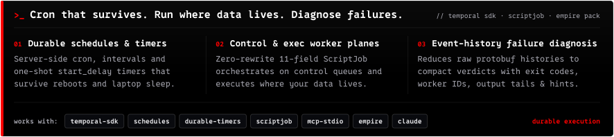
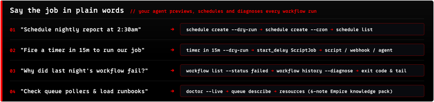
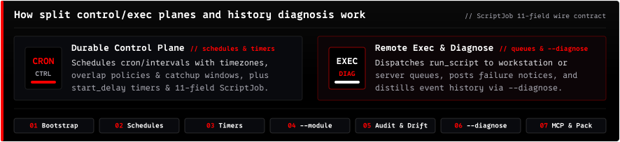

<a name="legends-temporal"></a>

# 

[](https://github.com/avalonreset/legends-temporal/releases/latest)
[](pyproject.toml)
[](docs/CLI-CONTRACT.json)
[](knowledge/temporal/pack.json)
[](LICENSE)

**Durable Temporal cluster control CLI, zero-rewrite `ScriptJob` and `AgentJob` worker runtime, first-class `cto-legends` `--module` scheduler, orphaned-queue and inventory drift auditor (`audit`), local/Docker/systemd cluster bootstrapper (`bootstrap`), compact event-history failure diagnosis, confirm-gated stdio MCP server, and 7-note operational knowledge pack (`legends-temporal`) for coding agents: replace fragile crontabs, `sleep` loops, and rate-limited chat-app schedulers with industry-standard server-side schedules and `start_delay` timers across split control and exec task queues.**


```text
Install or update legends-temporal via cto-legends (https://github.com/avalonreset/cto-legends): run `cto-legends install legends-temporal --apply`, then `cto-legends handoff legends-temporal` and follow the returned JSON recipe to verify `legends-temporal doctor`.
```



## Why `legends-temporal` exists

Relying on host crontabs, OS task schedulers, background `sleep` loops, built-in desktop chat-app schedulers, or raw workflow rewrites for agent-operated automation creates four immediate operational failure modes:

1. **Built-in chat-app scheduler limits and approval popups:** Desktop AI chat app schedulers enforce 1-hour minimum cadence walls, lock schedules inside a single vendor harness, and stall at 3:00 AM behind interactive UI confirmation modals when an unattended turn tries to run a tool.
2. **Fragile local clocks and lost background timers:** When a workstation sleeps, a container restarts, or an agent subshell closes, local `sleep && run` timers vanish and host crontabs miss their window with no catchup policy, overlap guard, or audit trail. And running `temporal server start-dev` without `--db-filename` runs in-memory only, wiping all schedules on exit.
3. **Brittle workflow rewrites and orphaned task queues:** Rewriting working Python scripts, `cto-legends` module runs, webhooks, and agent turns as custom Temporal workflow DAGs forces every task through sandbox determinism rules, while a schedule targeting an `exec_queue` whose worker stopped polling silently hangs without an automated poller cross-check.
4. **Opaque protobuf event histories and leaked secrets in arguments:** Raw Temporal history dumps flood an agent's context window with dozens of low-level protobuf events when a job fails, while passing webhook URLs or API tokens in raw CLI arguments permanently records secrets in the cluster database.

`legends-temporal` wraps any local dev, self-hosted Postgres, or Temporal Cloud cluster in an agent-operated Python 3.11+ CLI and stdio MCP server paired with a 7-note operational knowledge pack ([docs/KNOWLEDGE-PACK.md](docs/KNOWLEDGE-PACK.md) and [knowledge/temporal/pack.json](knowledge/temporal/pack.json)). One replay-safe `ScriptJob` workflow with a stable 11-field wire contract orchestrates on an always-on control queue while executing existing scripts, inline Python, any installed `cto-legends` module (`--module legends-...`), arbitrary `argv` commands, env-held webhooks, and agent session turns on the exec queue where your data lives. Every mutation supports `--dry-run` previews, `legends-temporal audit` catches orphaned queues, secret leaks, and declarative inventory drift in one pass, `legends-temporal bootstrap` launches SQLite-persisted local dev servers or hardened `127.0.0.1`/Tailscale Docker Compose stacks, and `workflow history --diagnose` distills any failed run into the exact exit code, worker identity, output tail, notice status, and remediation hint.

## Ask in plain english

Once [`cto-legends`](https://github.com/avalonreset/cto-legends) is installed, you ask your coding agent in plain english. It previews every schedule or timer before mutating the cluster, verifies live task-queue pollers, and diagnoses failures without dumping raw protobuf JSON into your chat:



- **"Schedule nightly report at 2:30am."** Runs `legends-temporal schedule create --id nightly-report --cron "30 2 * * *" --script scripts/nightly_report.py --dry-run` to preview the schedule spec, overlap policy, catchup window, and target queues offline, then creates or updates the schedule on the server and verifies it with `schedule list`.
- **"Fire a timer in 15m to run our job."** Runs `legends-temporal timer in 15m --dry-run` first, then starts a durable server-side `start_delay` workflow that survives reboots of the calling machine and dispatches `--script`, `--code`, `--command`, `--webhook-env`, or `--session --message` to the exec queue when the timer fires.
- **"Why did last night's workflow fail?"** Runs `legends-temporal workflow list --status failed` to locate the failed run, then executes `legends-temporal workflow history <workflow-id> --diagnose` to return a compact verdict containing `script_exit_code`, `script_worker`, `output_tail`, `failure_logged`, `notice`, and a targeted `hint`.
- **"Check queue pollers & load runbooks."** Runs `legends-temporal doctor --live` and `legends-temporal queue describe` to confirm gRPC connectivity, namespace registration, and live workflow/activity pollers across your queues, and runs `legends-temporal resources` to resolve the 6 Temporal notes for direct reading or [`legends-empire`](https://github.com/avalonreset/legends-empire) vault attachment.

## Architecture: split control and exec planes, 11-field `ScriptJob`, and `--diagnose`



### 1. Split control and exec task queues (`legends_temporal/runtime.py`)

`legends-temporal` separates orchestration from execution across two logical task-queue roles hosted by `legends-temporal worker --role control|exec|all`:

- **Durable Control Plane (`workflow_queue`):** Hosts the deterministic `ScriptJobWorkflow` and `log_failure` activity on an always-on server (or local dev process). The workflow imports only sandboxed dataclasses, reads no wall clock or local files, and stays replay-safe indefinitely because job behavior changes in data rather than workflow code.
- **Remote Exec Plane (`exec_queue`):** Hosts `run_script` and `notify_buzz` on the workstation, GPU box, or server that holds the target files, credentials, or agent harness. If an exec machine is asleep or offline when a schedule ticks, Temporal holds the activity in the queue up to `wait_for_worker_s` (6 hours by default) and runs it as soon as the worker reconnects.
- **Stable 11-field `ScriptJob` wire contract:** `runtime.to_wire()` normalizes every job into exactly 11 fields (`job_id`, `title`, `queue`, `interpreter`, `script`, `args`, `cwd`, `timeout_s`, `wait_for_worker_s`, `notify_channel`, `cron`). Scripts execute with `shell=False`, hard timeouts (exit code `124`), missing-binary detection (exit code `127`), and `maximum_attempts=1` so non-idempotent scripts are never double-run inside a single tick.

### 2. CLI command surfaces (`legends-temporal`)

| Surface | `legends-temporal` Command | What It Operates & Verifies |
| :--- | :--- | :--- |
| **Offline & Live Doctor** | `doctor`, `doctor --live` | Verifies Python 3.11+, `temporalio` SDK, resolved profile config, and knowledge-pack schema offline (`doctor`), or probes live gRPC connectivity, namespace state, task-queue pollers, optional Web UI HTTP status, and SSH `systemctl is-active` units (`doctor --live`). |
| **Schedule & Poller Auditor** | `audit [--file ...] [--offline]` | Offline validation of cron/interval syntax, IANA timezones, overlap pile-up risks, and secret/shell-sleep argument leaks (`--offline`), or live cluster cross-check flagging schedules whose `workflow_queue` or `exec_queue` has `0` live pollers, paused schedules, missed catchup windows, and 3-way inventory drift (`in_sync`, `missing_on_server`, `untracked_on_server`, `spec_drifted`). |
| **Cluster & Worker Bootstrap** | `bootstrap local\|compose\|systemd` | Launches or previews a SQLite-persisted local Temporal dev server (`--db-filename` enforced so schedules survive restarts), generates a hardened self-hosted PostgreSQL 16 + Temporal + UI Docker Compose stack bound strictly to `127.0.0.1` or a private IP (refusing `0.0.0.0`), or writes Linux `systemd` worker and daily `pg_dump` backup units. |
| **Schedules Lifecycle (`--module`)** | `schedule list\|describe\|create\|apply\|trigger\|pause\|unpause\|backfill\|delete` | Full server-side schedule lifecycle from CLI flags (including `--module <legends-module>` to schedule any installed `cto-legends` tool), JSON/YAML files (`examples/jobs.example.json`), or existing Python `module:ATTR` inventories with `--dry-run` previews, IANA timezones, jitter, overlap policies, `12h` catchup windows, and `--yes` delete guards. |
| **One-Shot Durable Timers** | `timer in <delay>` | Delayed execution (`30s`, `15m`, `2h`, `3d`, `1h30m`) built on Temporal `start_delay` across six modes: `--script`, `--code`, `--module <legends-module>`, `--command`, `--webhook-env`, and `--session` / `--spawn`, with `--dry-run` and `--wait`. |
| **Workflow Control & `--diagnose`** | `workflow list\|describe\|history [--diagnose]\|start\|signal\|query\|cancel\|terminate` | Builds SQL-like visibility queries (`--status`, `--type`, `--id-prefix`, `--query`), controls running executions, and reduces raw protobuf event histories into compact JSON verdicts (`workflow history <id> --diagnose`). |
| **Namespaces & Queue Pollers** | `namespace list\|describe`, `queue describe` | Lists registered namespaces with retention TTLs and cluster/server versions, and inspects workflow and activity pollers on each task queue with poller age (`<= 120s` live threshold) and throughput rates. |
| **Python Inventories & Fleet Gate** | `job list`, `job run <id>`, `agents` | Lists or immediately runs jobs from a profile's `jobs_source` / `canaries_source` Python inventory, preflights configured agent controllers (`agents`), and includes a config-driven fleet auto-update gate engine (`legends_temporal.fleet_update`). |
| **Worker, Stdio MCP & Resources** | `worker --role control\|exec\|all`, `mcp`, `config show\|init`, `resources` | Runs the `ScriptJob` worker, serves 10 MCP tools over newline-delimited stdio JSON-RPC 2.0 (`legends-temporal mcp`), manages `~/.legends-temporal/config.json` with secret redaction, and resolves absolute paths to all recipes, contracts, and knowledge notes. |

### 3. Attachable 7-note Temporal knowledge pack (`knowledge/temporal/`)

Source checkouts and wheel installs ship a 7-note Temporal operational library (`knowledge/temporal/pack.json`, schema `legends.knowledge-pack/v1`). Run `legends-temporal resources --json` to resolve local paths or attach the pack into a [`legends-empire`](https://github.com/avalonreset/legends-empire) vault:

1. `01-temporal-mental-model-and-determinism.md`: Frontend gRPC, namespaces, task queues, workflows, activities, workers, and sandbox replay determinism.
2. `02-schedules-and-durable-timers.md`: Replacing cron, Task Scheduler, and local sleep loops with server-side schedules and `start_delay` timers.
3. `03-zero-rewrite-scriptjob-and-agentjob-pattern.md`: Wrapping existing scripts, inline Python, `cto-legends` modules (`--module`), `argv` commands, env-held webhooks, and agent session turns in the 11-field `ScriptJob` contract.
4. `04-timeouts-retries-and-idempotency.md`: Choosing `schedule_to_start`, `start_to_close`, and `execution_timeout` values and keeping jobs safe to rerun.
5. `05-self-hosted-postgres-and-tailnet-hardening.md`: Binding self-hosted Temporal + PostgreSQL to private networks, mTLS, Temporal Cloud API keys, and keeping secrets out of history.
6. `06-visibility-queries-and-failure-diagnosis.md`: Visibility list filters, reading `--diagnose` verdicts, and checking task-queue pollers.
7. `07-why-not-cron-or-built-in-agent-schedulers.md`: Why built-in chat-app schedulers (1-hour walls, UI approval popups, single-vendor lock-in), host crontabs, and shell sleep loops fail autonomous agents, and how `--module` schedules any `cto-legends` capability.

## Fragile crontabs & sleep loops vs `legends-temporal`


## Quick start

Start a local dev server (`temporal server start-dev` on `localhost:7233`), or point `TEMPORAL_ADDRESS` and `TEMPORAL_NAMESPACE` (or a named profile in `~/.legends-temporal/config.json`) at your self-hosted or Temporal Cloud cluster.

```sh
# 1. Initialize portable config and verify offline + live cluster readiness
legends-temporal config init
legends-temporal doctor
legends-temporal doctor --live

# 2. Start a ScriptJob worker (control + exec roles in one process, or split across hosts)
legends-temporal worker --role all

# 3. Preview and fire a one-shot durable timer in 10 seconds
legends-temporal timer in 10s --code "print('durable timer ok')" --dry-run --json
legends-temporal timer in 10s --code "print('durable timer ok')" --wait --json

# 4. Preview and apply recurring schedules from flags or a JSON definitions file
legends-temporal schedule create --id heartbeat --interval 15m --code "print('alive')" --dry-run
legends-temporal schedule create --id heartbeat --interval 15m --code "print('alive')"
legends-temporal schedule apply --file examples/jobs.example.json --dry-run
legends-temporal schedule list

# 5. Inspect recent workflow executions and diagnose any run from its event history
legends-temporal workflow list --limit 5
legends-temporal workflow history YOUR_WORKFLOW_ID --diagnose --json
```

All commands support `--json` and deterministic exit codes (`0` ok, `1` error, `2` usage, `3` not found, `4` workflow failed, `5` cannot connect; see [docs/CLI-CONTRACT.json](docs/CLI-CONTRACT.json)).

## Reference

<details>
<summary><strong>Agent setup (via <code>cto-legends</code>) and standalone installation</strong></summary>

### Agent setup (via `cto-legends`)

The shared [`cto-legends`](https://github.com/avalonreset/cto-legends) skill discovers the module and loads its [agent recipe](docs/AGENT-RECIPE.md) on demand. It is the only registered skill; no separate per-module skill registration is required.

```sh
cto-legends sync --apply
cto-legends install legends-temporal --apply
cto-legends handoff legends-temporal
cto-legends run legends-temporal -- doctor
```

For an existing managed installation, use `cto-legends update legends-temporal --apply`. Omit `--apply` to preview installation or updates.

### Standalone install

Requires Python 3.11 or newer on Windows, macOS, or Linux with `temporalio>=1.8`. Install the optional `[yaml]` extra if you load YAML schedule files.

```sh
git clone https://github.com/avalonreset/legends-temporal.git
cd legends-temporal
python -m pip install .
legends-temporal doctor
legends-temporal resources
```

</details>

<details>
<summary><strong>Stdio MCP server (<code>legends-temporal mcp</code>) and profile configuration</strong></summary>

### Stdio MCP server

`legends-temporal mcp` exposes 7 read-only inspection tools plus 1 confirm-gated timer tool over newline-delimited stdio JSON-RPC 2.0:

```json
{
  "mcpServers": {
    "legends-temporal": {
      "command": "legends-temporal",
      "args": ["mcp"]
    }
  }
}
```

Tools: `temporal_doctor`, `temporal_namespace_list`, `temporal_queue_describe`, `temporal_schedule_list`, `temporal_schedule_describe`, `temporal_workflow_list`, `temporal_workflow_diagnose`, and `temporal_timer_schedule` (returns a preview unless `confirm: true` is passed). See [docs/INTEGRATIONS.md](docs/INTEGRATIONS.md).

### Profile resolution precedence

1. CLI flags (`--address`, `--namespace`)
2. Environment variables (`TEMPORAL_ADDRESS`, `TEMPORAL_NAMESPACE`, `TEMPORAL_API_KEY`, `TEMPORAL_TLS_CERT`, `TEMPORAL_TLS_KEY`, `TEMPORAL_TLS_CA`)
3. Selected profile in `~/.legends-temporal/config.json` (`--profile`, `LEGENDS_TEMPORAL_PROFILE`, or `default_profile`)
4. First profile with `"detect": true` whose address answers a TCP probe
5. Portable defaults (`localhost:7233`, namespace `default`, queues `legends-temporal`, timezone `UTC`, `stdout` notices)

See [docs/ONBOARDING.md](docs/ONBOARDING.md) and [docs/ARCHITECTURE.md](docs/ARCHITECTURE.md).

</details>

<details>
<summary><strong>Repository layout, verification, and FAQ</strong></summary>

| Location | Purpose |
| :--- | :--- |
| `legends_temporal/` | Python 3.11+ CLI, gRPC client, config resolver, `ScriptJob` runtime/worker, schedules, timers, diagnosis, stdio MCP server, and fleet update gate |
| `docs/` | Canonical [agent recipe](docs/AGENT-RECIPE.md), [CLI contract](docs/CLI-CONTRACT.json), [architecture](docs/ARCHITECTURE.md), [onboarding](docs/ONBOARDING.md), [integrations](docs/INTEGRATIONS.md), [troubleshooting](docs/TROUBLESHOOTING.md), [live canary](docs/LIVE-CANARY.md), and [release verification](docs/RELEASE.md) |
| `knowledge/temporal/` | 6-note `legends.knowledge-pack/v1` Temporal operational pack ([knowledge/temporal/pack.json](knowledge/temporal/pack.json)) |
| `examples/` | Declarative JSON schedule inventory example ([examples/jobs.example.json](examples/jobs.example.json)) |
| `tests/` | Offline contract, parser, synthetic protobuf diagnosis, runtime, MCP, fleet-update, and portability test suite |
| `skills/cto-legends/SKILL.md` | Pinned copy of the central [`cto-legends`](https://github.com/avalonreset/cto-legends) router skill |

```sh
python -m pytest -q
python scripts/check_release.py
legends-temporal doctor
```

**Do I need to rewrite my Python or shell scripts as Temporal workflows?**
No. `legends-temporal` ships a single replay-safe `ScriptJob` workflow that executes existing scripts (`--script`), inline Python (`--code`), arbitrary `argv` commands (`--command`), env-held webhooks (`--webhook-env`), or agent session turns (`--session` / `--spawn`) unchanged on your exec worker queue.

**How does `legends-temporal` keep secrets out of Temporal history?**
Temporal stores workflow inputs and activity results in its database. `legends-temporal` reads API keys (`api_key_env`), webhook URLs (`--webhook-env`), and notification credentials from environment variables or files on the worker at runtime, and `config show` reduces API keys to `api_key_present: true|false`.

</details>

## Contributing, security, and license

Read [CONTRIBUTING.md](CONTRIBUTING.md), [AGENTS.md](AGENTS.md), [SECURITY.md](SECURITY.md), [PRIVACY.md](PRIVACY.md), and [docs/RELEASE.md](docs/RELEASE.md).

MIT licensed. See [LICENSE](LICENSE), [NOTICE](NOTICE), [THIRD_PARTY_NOTICES.md](THIRD_PARTY_NOTICES.md), and [SUPPORT.md](SUPPORT.md).

[](https://github.com/avalonreset/cto-legends/issues/new?title=Message%20for%20Avalon%20Reset&labels=message)

<p align="center"><a href="https://github.com/stars/avalonreset/lists/cto-legends"></a></p>

**Specification & benchmarks on cto-legends.com:**
- **Module specification & architecture matrix:** [cto-legends.com/modules/legends-temporal](https://cto-legends.com/modules/legends-temporal)
- **Related engineering dispatches:** [How to Build AI Agents: Production CLI & MCP Routing](https://cto-legends.com/blog?post=how-to-build-ai-agents-cli-mcp-routing) · [Hetzner vs AWS & DigitalOcean: Cloud Server Planning](https://cto-legends.com/blog?post=hetzner-vs-aws-digitalocean-cloud-server-planning)
- **Ecosystem hub:** [cto-legends.com/home](https://cto-legends.com/home)
